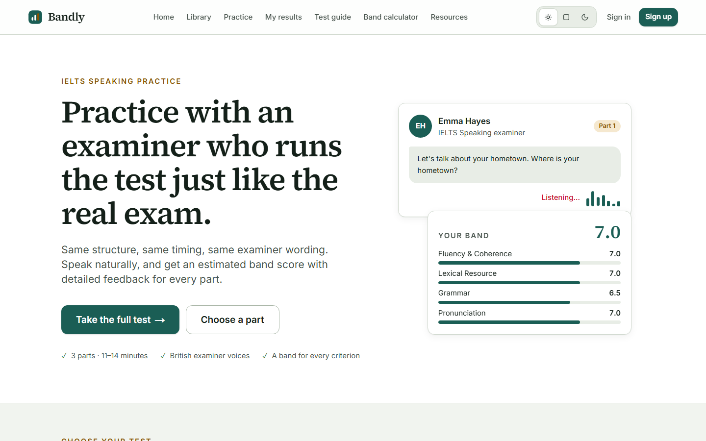
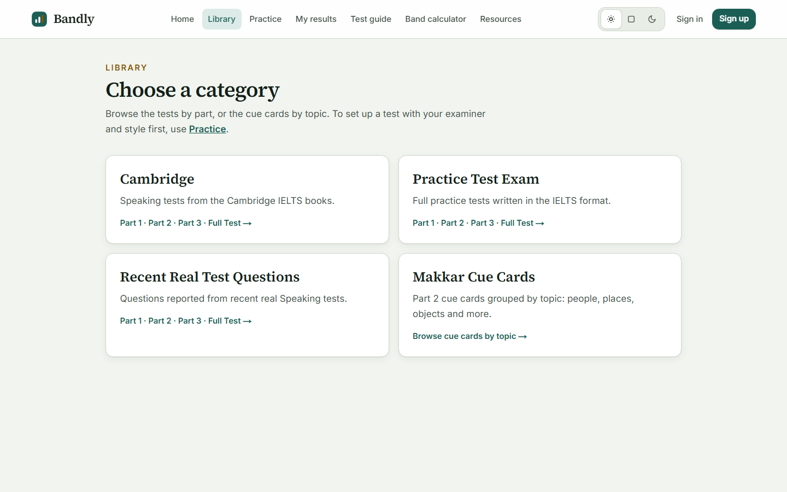
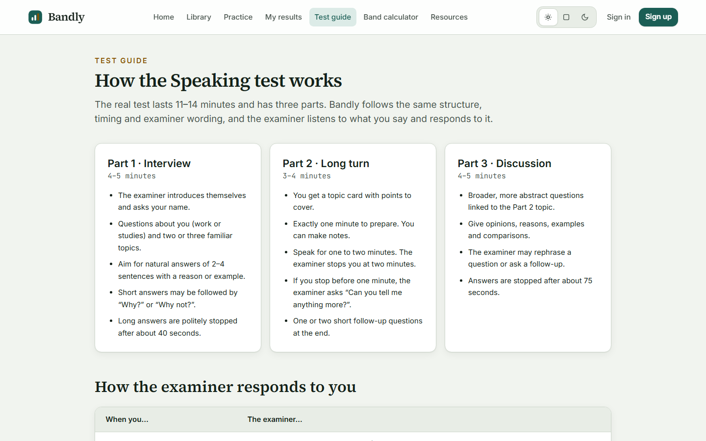
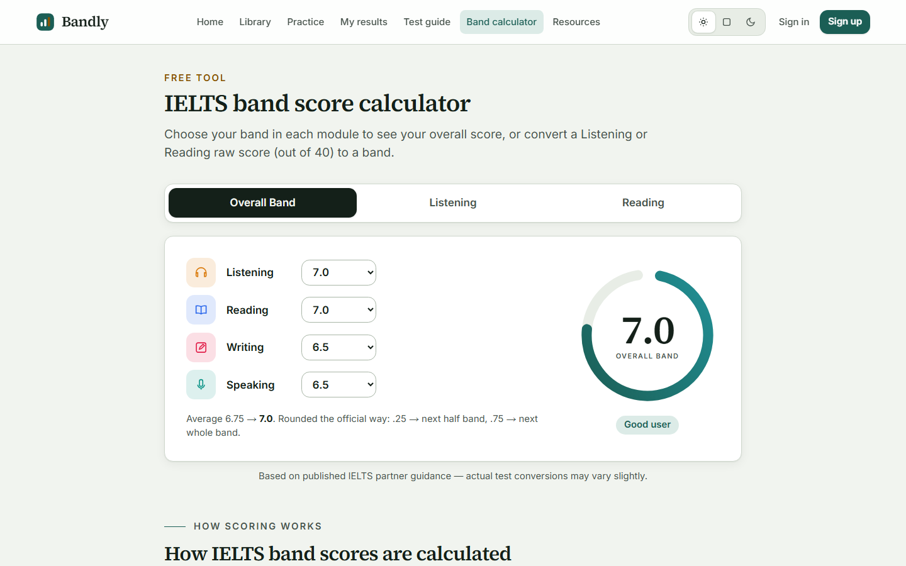
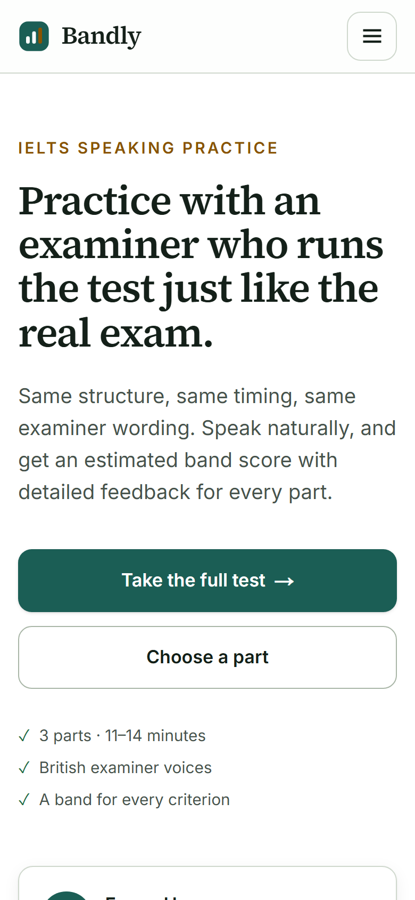

<div align="center">


# Bandly

**Practice IELTS Speaking with an examiner who listens and responds.**

An AI speaking examiner that runs the full three-part IELTS Speaking test with official timings and a British examiner voice. It understands what you say, reacts like a real examiner, and gives you an estimated band score with feedback on all four criteria.

[**Live demo: bandlytest.vercel.app**](https://bandlytest.vercel.app)

[](https://nextjs.org)
[](https://react.dev)
[](https://www.typescriptlang.org)
[](https://www.postgresql.org)
[](https://groq.com)

</div>

<p align="center">
  
</p>

## Table of contents

- [Why Bandly](#why-bandly)
- [Features](#features)
- [Screenshots](#screenshots)
- [Tech stack](#tech-stack)
- [Run it locally](#run-it-locally)
- [Environment variables](#environment-variables)
- [Testing](#testing)
- [Project structure](#project-structure)
- [License](#license)

## Why Bandly

Most IELTS candidates never practise Speaking under real exam conditions. A human tutor is expensive, and most apps only show a question and record you. Bandly recreates the actual test:

- the same structure, timing and examiner wording;
- an examiner who listens and responds to what you say;
- a band estimate on the official criteria, so you know what to improve before test day.

## Features

- **The real exam flow.** Part 1 interview, Part 2 cue card (one minute to prepare, up to two minutes to speak) and Part 3 discussion, with official timings and examiner wording.
- **An examiner who listens.** Every answer is transcribed with Whisper. An LLM then decides how the examiner reacts:
  - a follow-up question;
  - "Can you tell me anything more?";
  - politely stopping a long answer;
  - moving on.
- **British examiner voices.** Choose Emma (female) or James (male). Every line is pre-rendered with Kokoro TTS. If a line isn't rendered yet, it falls back to a browser voice of the same gender.
- **Band scores with feedback.** Fluency and Coherence, Lexical Resource, Grammar, and Pronunciation are each scored per part, with an overall band.
- **A real question library.** Cambridge IELTS 10–21 tests by part, practice tests, recent real-test questions, and cue cards grouped by topic.
- **Admin panel.** Create, edit, reorder and organise tests, questions and cue cards. Changes go straight into the exam engine, with role-based access (user, admin, superadmin).
- **Robust audio.** Microphone checks before the test, recovery if the microphone disconnects, and captions when no suitable voice is available.
- **Model fallback chain.** If a Groq model is rate limited or down, the next model in the chain takes over.
- **Free tools.** An IELTS band score calculator (overall band, and Listening or Reading raw scores) and a curated resources page.
- **Designed for every screen.** Light, dark and system themes, and a responsive layout from small phones to wide desktops.


## Screenshots

<table>
  <tr>
    <td width="50%"></td>
    <td width="50%"></td>
  </tr>
  <tr>
    <td align="center"><b>Question library</b>: Cambridge tests, practice tests and cue cards</td>
    <td align="center"><b>Test guide</b>: how each part works</td>
  </tr>
  <tr>
    <td width="50%"></td>
    <td width="50%" align="center"></td>
  </tr>
  <tr>
    <td align="center"><b>Band score calculator</b>, rounded the official way</td>
    <td align="center"><b>Mobile</b>: fully responsive</td>
  </tr>
</table>

## Tech stack

| Area | Technology |
| --- | --- |
| Framework |    App Router, Cache Components, route handlers |
| UI |  Responsive design, light and dark themes |
| Speech-to-text |  Whisper Large v3 Turbo, with Whisper Large v3 as fallback |
| LLMs |  Qwen 3, GPT-OSS 120B / 20B (configurable fallback chains for live listening and scoring) |
| Examiner voice |  Pre-rendered British voices, with a gender-matched Web Speech API fallback |
| Audio | MediaRecorder and Web Audio API (microphone capture, level meter, reconnect handling) |
| Auth |  Role-based access: user, admin, superadmin |
| Database |   PostgreSQL 17 in Docker for local development |
| Validation |  Typed, validated environment |
| Testing |   Unit, database and end-to-end tests with a simulated microphone |
| DevOps |    |
| Tooling |   ESLint, Prettier |

## Run it locally

### Prerequisites

- [Node.js](https://nodejs.org) 22 or newer (24 recommended, see `.nvmrc`)
- [pnpm](https://pnpm.io) 11 (`corepack enable` sets it up)
- [Docker Desktop](https://www.docker.com/products/docker-desktop/), for the local PostgreSQL database
- Free accounts at [Groq](https://console.groq.com) and [Clerk](https://dashboard.clerk.com)
- Optional: [Python](https://www.python.org) 3.13, only to re-render examiner voices

### Quick start

```bash
# 1. Get the code
git clone https://github.com/Aman554-EQ/Bandly-IELTS-Speaking-APP.git
cd Bandly-IELTS-Speaking-APP

# 2. Install dependencies
pnpm install

# 3. Create your settings file, then add your keys (see Environment variables)
cp .env.example .env.local        # Windows PowerShell: Copy-Item .env.example .env.local

# 4. Start PostgreSQL in Docker, create the tables and load the starter content
pnpm db:setup                     # = pnpm db:up && pnpm db:migrate && pnpm db:seed

# 5. Run the app
pnpm dev
```

Open [http://localhost:3000](http://localhost:3000), sign up and start a test. **Allow microphone access** when the browser asks.

### Make yourself an admin (optional)

1. Set `BOOTSTRAP_SUPERADMIN_EMAIL` (and optionally `BOOTSTRAP_ADMIN_EMAIL`) in `.env.local`.
2. Run `pnpm bootstrap:admins`.
3. Sign in with that email. If you don't have a password yet, use "Forgot password?" or an email code to set one. Your account then opens the **Superadmin** and **Admin** areas.

### Use a hosted database instead of Docker

Any PostgreSQL 15+ works. [Neon](https://neon.tech) has a free tier:

1. Put the **pooled** connection string in `DATABASE_URL` and the **direct** one in `DATABASE_URL_UNPOOLED`.
2. Run `pnpm db:migrate && pnpm db:seed`.

### Commands

| Command | What it does |
| --- | --- |
| `pnpm dev` | Development server on port 3000 |
| `pnpm build` / `pnpm start` | Production build / serve it |
| `pnpm check` | Typecheck, lint and unit tests |
| `pnpm format` | Prettier |
| `pnpm db:up` / `pnpm db:down` | Start / stop the PostgreSQL container (data is kept) |
| `pnpm db:migrate` | Apply database migrations |
| `pnpm db:seed` | Load roles, modules and starter content (safe to re-run) |
| `pnpm db:studio` | Browse the database in Drizzle Studio |
| `pnpm db:backup` | Dump the database to `backups/` |
| `pnpm bootstrap:admins` | Create the first superadmin and admin |
| `pnpm voice:setup` | Download the Kokoro voice models (~340 MB, once) |
| `pnpm voice:render` | Render missing examiner lines as audio clips |

### Examiner voices (optional)

The rendered clips are already in `public/voice/`, so the app works without Python. After you add or reword questions in the admin panel, render the new lines:

```bash
python -m venv .venv
# macOS/Linux: source .venv/bin/activate    Windows: .venv\Scripts\activate
pip install -r tools/voice/requirements.txt
pnpm voice:setup
pnpm voice:render
```

## Environment variables

All settings live in one file: `.env.local` locally, or your host's environment variables in production. `.env.example` lists every variable with comments. **Never commit `.env.local`.**

| Variable | Required | Description |
| --- | --- | --- |
| `GROQ_API_KEY` | ✅ | Speech-to-text and scoring. Get a free key at [console.groq.com/keys](https://console.groq.com/keys). |
| `GROQ_STT_MODEL`, `GROQ_STT_FALLBACK_MODEL` | | Whisper models (defaults are set). |
| `GROQ_LLM_MODELS`, `GROQ_FAST_MODELS` | | Comma-separated model chains for scoring and live listening, strongest first. |
| `GROQ_TIMEOUT_MS` | | Timeout for each Groq request, in milliseconds (default `30000`). |
| `DATABASE_URL` | ✅ | PostgreSQL connection string. The value in `.env.example` works with Docker. |
| `DATABASE_URL_UNPOOLED` | ✅ | Direct (non-pooled) connection, used for migrations. |
| `NEXT_PUBLIC_CLERK_PUBLISHABLE_KEY` | ✅ | [Clerk dashboard](https://dashboard.clerk.com) → your application → **API keys**. |
| `CLERK_SECRET_KEY` | ✅ | Same page as above. |
| `CLERK_WEBHOOK_SIGNING_SECRET` | | Only for Clerk webhooks (`/api/webhooks/clerk`). Users also sync on first sign-in. |
| `BOOTSTRAP_SUPERADMIN_EMAIL`, `BOOTSTRAP_ADMIN_EMAIL` | | Used only by `pnpm bootstrap:admins`. |
| `DATABASE_URL_TEST`, `E2E_CLERK_USER_EMAIL` | | Only for the database and end-to-end tests. |

## Testing

| Suite | Command | What it covers |
| --- | --- | --- |
| Unit | `pnpm test` | Exam engine on a simulated clock, scoring, voice selection, permissions |
| Database | `pnpm test:db` | Repositories, auth and roles, admin content operations, webhooks (needs `pnpm db:up`) |
| End-to-end | `pnpm test:e2e` | Full exams in Chromium with a fake microphone, admin flows, responsive layouts |
| Live | `pnpm test:live` | Real Groq listening round trip (needs `GROQ_LIVE=1` and the dev server) |

Before running the end-to-end tests the first time, install the browser: `pnpm exec playwright install chromium`. GitHub Actions runs typecheck, lint and unit tests on every push.

## Project structure

```
src/
├── app/            Pages and API routes (Next.js App Router)
│   ├── practice/   Test setup wizard and exam room
│   ├── library/    Tests by part and cue cards by topic
│   ├── admin/      Content management (tests, questions, cue cards)
│   ├── superadmin/ User and role management
│   └── api/        Sessions, turns, scoring, admin, webhooks
├── engine/         Exam engine: pure TypeScript, blueprint compiler and script
├── audio/          Microphone capture and examiner voice playback
├── components/     UI: exam room, admin, homepage, shared components
├── content/        Band tables, resources, question kinds
└── server/
    ├── db/         Drizzle schema, repositories and seed
    ├── auth/       Clerk session, users and permission policy
    ├── groq.ts     The single Groq client (STT and LLM fallback chains)
    └── scoring.ts  Band scoring and turn analysis
drizzle/            SQL migrations
public/voice/       Pre-rendered examiner voice clips
tools/voice/        Kokoro voice renderer (Python)
tests/              Database, end-to-end and live tests
```

## License

© [Aman554-EQ](https://github.com/Aman554-EQ). All rights reserved. Shared for learning and portfolio purposes.
